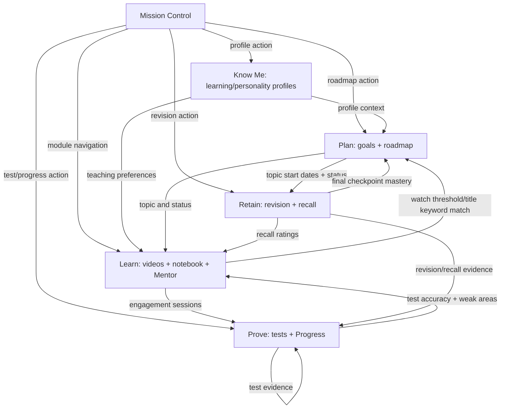

# Mission Control — Phase 1 System Intelligence & Connection Audit

**Audit baseline:** `main` at `d079c56044caaad529e0c61d3c451b8bd0ad1743` (2026-11-04)  
**Scope:** Existing Mission Control stages, connected learning systems, state ownership, persistence, hydration, and verified cross-module flows.  
**Change policy:** Audit/documentation only. No learner data schema, database, working engine, or Mission Control map was changed in this phase.

## Executive summary

Learning OS already has several real cross-module integrations. Mission Control is the navigation and summary surface over them; it is not yet the central orchestrator of all learner activity. The five-stage map is implemented in `src/MissionControl.tsx`, but the map's node connections are primarily visual/navigation relationships. The real data flows happen in the underlying stores and feature modules.

The most important confirmed distinction:

- **Real integrations:** roadmap progress ↔ video engagement; roadmap ↔ revision; revision recall ↔ Mentor and Progress; test attempts ↔ Progress mastery; learner profile ↔ roadmap generation, Mentor and video personalization; notebook ↔ cloud sync.
- **Navigation/context handoffs:** Mission Control stage cards open modules; some modules open contextual tools, but this does not mean every action is recorded in a shared learning-event model.
- **Local-only evidence:** video engagement/watch history, Mentor chat history, AI-generated Deep Notes cache, Research history/cache, Dictionary recent searches, Current Affairs saved points, and Daily Test scheduling state are currently browser/device scoped in the inspected stores.

## 1. Mission Control surface — what it actually owns

**Source:** `src/MissionControl.tsx`, `src/missionControlLogic.ts`, `src/Dashboard.tsx`.

Mission Control receives a compact set of props from Dashboard:

- learner display name and active goal title;
- current topic title and its time/difficulty detail;
- whether a Learning Profile exists;
- due-today and overdue revision counts;
- streak and active-goal count;
- navigation/profile/continue-learning callbacks.

The five core rows are hard-coded in Mission Control:

| Stage | Available action(s) in the map | Actual destination |
|---|---|---|
| Know Me | Mind Blueprint | Profile interview |
| Plan | Learning Roadmap | Roadmap |
| Learn | Video Intelligence, Notes Workspace, AI Mentor | Videos, Notes, Mentor |
| Retain | Revision Room | Revision |
| Prove | Tests and Practice, Growth and Progress | Test, Progress |

Research, Dictionary and Current Affairs are additional function nodes, not additional core stages.

### Verified current decision logic

`getNextBestStepAction()` only evaluates three facts, in this order:

1. no learning profile → profile;
2. any due-today or overdue revision → revision;
3. otherwise → roadmap.

`getContinueLearningTarget()` only checks whether a current topic exists: videos if true, roadmap otherwise. Dashboard then attempts to open the saved video for that topic.

**Conclusion:** the map is a real navigation hub with a small live summary, but its stage-to-stage visual lines do not themselves represent a live event graph. The recommendation engine does not yet consider incomplete videos, test performance, weak concepts, current learning session, or notes.

## 2. Verified data-flow map

The arrows above represent code-level reads/writes found in the inspected modules. They do not imply that every record is synchronized across devices.

### Stage-by-stage evidence

| Stage | Existing source of truth | Verified downstream connections | Classification |
|---|---|---|---|
| Know Me | `learningProfileStore.ts`, `personalityProfileStore.ts` | Learning profile is included in roadmap generation; Mentor derives teaching directives; Video uses the learning profile; engagement can update the profile through `implicitProfileUpdate.ts`. | Real integration |
| Plan | `goalsStore.ts`, `roadmapData.ts` | Roadmap is goal-scoped; it provides current topic and topic status to Mission Control, Video, Revision, Mentor and Progress. | Real integration |
| Learn — Videos | `VideoIntel.tsx`, `engagementStore.ts`, local video state | Watch sessions are written locally; watch percentage plus title/topic-keyword matching can change roadmap topic status; engagement signals contribute to Progress mastery. | Real integration, local-only evidence |
| Learn — Notes | `notebookStore.ts` + IndexedDB; `Notes.tsx` local caches | Notebook supports note/video linkage and its own cloud sync; AI Deep Notes cache is separate and local-only. | Real integration in notebook; separate local cache for AI notes |
| Learn — Mentor | `mentorContext.ts`, `mentorChatStore.ts` | Mentor context reads profile, active goals, current roadmap topic, weak areas, due reviews and recent recall; chat history itself is stored per-user on the device. | Real contextual integration; local-only chat history |
| Retain | `revisionData.ts`, `revisionstore.ts`, `revisionRecallStore.ts` | Revision schedule is derived from roadmap topics; recall ratings adjust later intervals; final checkpoint can mark the roadmap topic mastered. Mentor and Progress reuse the same revision data. | Real integration |
| Prove — Tests | `testBankStore.ts`, `testStore.ts`, `dailyTestStore.ts` | Test papers and completed attempts sync best-effort; Progress uses scored attempts as topic-level evidence. Daily Test state is local-only. | Partial real integration |
| Prove — Progress | `progressData.ts`, `topicMastery.ts`, `progressMetrics.ts` | Aggregates roadmap status, video engagement, revision recall and exact normalized topic-title test results. | Real read/aggregation integration |

## 3. What is connected versus navigation-only

### Confirmed real integrations

1. **Profile → Roadmap generation:** `App.tsx` passes the saved Learning Profile and personality brief into `/api/generate-roadmap`.
2. **Profile → Mentor:** `mentorContext.ts` builds teaching directives from the Learning Profile and adds goal, topic, weak-area and revision context.
3. **Roadmap → Video:** Roadmap passes goal/topic context into Video; video search state is keyed by goal and topic.
4. **Video → Roadmap:** `VideoIntel.tsx` updates topic status when watch-percentage thresholds and title keyword matches are satisfied. This is rule-based, not a semantic topic classifier.
5. **Roadmap → Revision:** Revision checkpoints are derived from each active goal's roadmap and learning-start timestamps.
6. **Revision → Roadmap:** Completing the final revision checkpoint can mark a topic mastered and unlock the next topic.
7. **Revision → Mentor/Progress:** Both reuse the revision schedule and recall records; there is no second revision queue in Mentor.
8. **Tests → Progress:** Progress uses recent scored attempts matching the normalized topic title.
9. **Video + Revision + Tests + Roadmap → Progress:** Progress combines roadmap status, engagement feedback, observed recall and test accuracy.

### Navigation or partial/context-only connections

- Mission Control stage nodes route to their modules; they do not own or dispatch a universal learning event.
- Notes, Research and Dictionary can be opened from learning workflows, but their general caches/history are not part of the Progress mastery calculation.
- Current Affairs saved items are not currently connected to the roadmap/revision/progress pipeline.
- A video being selected/saved is not equivalent to a completed learning event.
- A test being created is not proof of mastery; only scored attempts are used as test evidence.

## 4. Persistence and hydration ownership

The application deliberately uses multiple existing stores. This is not a single database and should not be collapsed into one during the next phases.

| Data | Local persistence | Cloud persistence | Hydration timing |
|---|---|---|---|
| Learning Profile | localStorage | Firestore best-effort | Dashboard entry via `App.tsx` |
| Personality Profile | localStorage | Firestore best-effort | Dashboard entry |
| Goals | localStorage | Firestore best-effort | Dashboard entry |
| Roadmaps | localStorage, goal-scoped | Firestore best-effort | Only when Roadmap opens, active goal only |
| Revision checkpoints | localStorage | Firestore best-effort | Only when Revision opens |
| Recall ratings | localStorage | Firestore best-effort | Only when Revision opens |
| Test bank and attempts | localStorage | Firestore best-effort | Only when Test opens |
| Daily Test queue/state | localStorage | No cloud sync in inspected store | Local |
| Video engagement/watch history/search state | localStorage | No personal cloud sync in inspected store | Local |
| Notebook index | localStorage + memory | Firestore | Notebook opens; content pages in IndexedDB |
| Notebook page content | IndexedDB | Firestore note/ink documents | Notebook opens / note accessed |
| Mentor chat history | UID-scoped localStorage | No cloud sync in inspected store | Local |
| AI Deep Notes cache | localStorage | No cloud sync in inspected store | Local |
| Research state/cache | localStorage | No cloud sync in inspected store | Local |
| Dictionary recent searches | localStorage | No cloud sync in inspected store | Local |
| Current Affairs saved points | localStorage | No cloud sync in inspected store | Local |
| Active-day streak | localStorage | Firestore best-effort | Dashboard entry |

### Cloud sync implementation

`cloudSync.ts` uses Firestore documents under `users/{uid}/data/{key}`.

- `pushToCloud()` is fire-and-forget and catches errors without exposing a result to most callers.
- `pullFromCloud()` returns `null` for signed-out, missing, or failed reads; callers cannot distinguish those cases from the returned value alone.
- `pushToCloudChecked()` returns a boolean and is used by the notebook for truthful save-state feedback.
- `subscribeCloud()` supports server-originated updates and is used by the notebook index.
- Most other stores retain localStorage as their synchronous read source and hydrate cloud data only when the owning section opens.

The notebook is materially more advanced than the generic stores: IndexedDB content, per-note cloud documents, checked writes, conflict handling, queued saves, live index subscription, and explicit save states (`saved`, `saving`, `local`, `offline`, `error`).

## 5. Confirmed risks and Phase 2/3/4 handoff

These are audit findings, not changes made in Phase 1.

### P1 — Mission Control can display incomplete cloud-hydrated context on a new device

Dashboard entry hydrates Learning Profile, Personality Profile, Goals and active days. Roadmaps hydrate only when Roadmap opens; revision checkpoints and recall hydrate only when Revision opens; tests hydrate only when Test opens.

Mission Control computes its current topic and revision summary from local reads. Therefore, on a new browser/device, the initial map recommendation can be based on incomplete local data until those owning pages hydrate. This should be addressed in Phase 2 with a deliberate, bounded Mission Control context hydration/read model that reuses existing stores—without duplicating storage.

### P2 — Next-action logic is much narrower than the available evidence

Mission Control receives only profile existence, current topic, due/overdue revision counts, streak and active-goal count. Progress already computes weak topics and combines roadmap, engagement, recall and test evidence, but this evidence is not currently supplied to Mission Control's next-step decision.

Phase 2 should define priority, confidence, tie-breaking and explanation rules before changing the engine.

### P3 — Video → Roadmap matching is heuristic

The watch-to-topic integration uses title substring matches against each topic's `topicKeywords` and fixed 70%/85% thresholds. It can miss relevant videos whose titles use different wording or match multiple topics. Phase 2 should measure/guard this existing behavior before replacing or extending it.

### P4 — Local-only learning evidence limits cross-device continuity

Video engagement, watch history, Mentor chat, Daily Test state and several research/discovery caches are device-local in the inspected code. Some are intentionally local for privacy or lightweight UX. Do not cloud-sync them indiscriminately. Phase 4 should decide data-by-data whether cross-device persistence is necessary, consented, and safe.

### P5 — Generic cloud-sync failures are intentionally silent

Most stores cannot tell the UI whether a Firestore write succeeded. The notebook already has a richer checked-sync/status implementation. Phase 4 should improve feedback by extending truthful status only where needed, rather than changing every store or introducing a second sync system.

### P6 — Test evidence association depends on exact topic-title matching

`topicMastery.ts` normalizes Unicode and punctuation but still requires exact normalized equality between test topic and roadmap topic title. Renamed or differently phrased test topics will not contribute to that roadmap topic's mastery evidence.

### P7 — Engagement and test evidence have different persistence/availability behavior

Progress reads engagement sessions from localStorage and test attempts from a cloud-hydrated store. The same Progress view may therefore have complete test evidence but incomplete video evidence on a new device. The UI should not imply stronger mastery certainty than the available evidence supports.

## 6. Guardrails for the remaining phases

- Keep the existing Mission Control map permanently visible and preserve all five stages.
- Keep existing store ownership and APIs unless a concrete issue requires a backwards-compatible extension.
- Do not create a second roadmap, revision queue, mastery score store, event database, or notebook store.
- Reuse `progressData.ts`, `revisionData.ts`, `mentorContext.ts`, `roadmapData.ts` and existing domain stores as evidence sources.
- Preserve goal-scoped roadmap behavior and existing local data compatibility.
- Treat private learner context and Mentor conversations as sensitive; no broad analytics/cloud replication without a clear need and consent.
- Test signed-out/guest, signed-in, new-device hydration, offline, refresh and multi-goal cases.
- Keep implementation on a feature branch; do not merge to `main` without explicit approval.

## 7. Files inspected

Core orchestration and map:
- `src/MissionControl.tsx`
- `src/missionControlLogic.ts`
- `src/Dashboard.tsx`
- `src/App.tsx`
- `src/AuthGate.tsx`

Profile, planning and roadmap:
- `src/learningProfileStore.ts`
- `src/personalityProfileStore.ts`
- `src/goalsStore.ts`
- `src/roadmapData.ts`
- `src/Roadmap.tsx`

Learning and support:
- `src/VideoIntel.tsx`
- `src/engagementStore.ts`
- `src/NotesHome.tsx`
- `src/Notes.tsx`
- `src/notebookStore.ts`
- `src/mentorContext.ts`
- `src/mentorChatStore.ts`

Retention, assessment and progress:
- `src/revisionData.ts`
- `src/revisionstore.ts`
- `src/revisionRecallStore.ts`
- `src/Test.tsx`
- `src/testBankStore.ts`
- `src/testStore.ts`
- `src/dailyTestStore.ts`
- `src/progressData.ts`
- `src/topicMastery.ts`
- `src/progressMetrics.ts`

Persistence and adjacent tools:
- `src/cloudSync.ts`
- `src/firebase.ts`
- `src/Research.tsx`
- `src/Dictionary.tsx`
- `src/caSavedStore.ts`
- `src/CurrentAffairs.tsx`

**Phase 1 outcome:** the current system boundaries, verified connections, local/cloud ownership, hydration sequence, and concrete implementation risks are documented. No runtime behavior has been changed by this audit.
